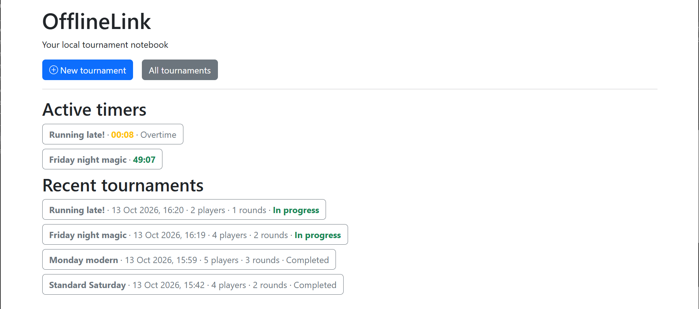
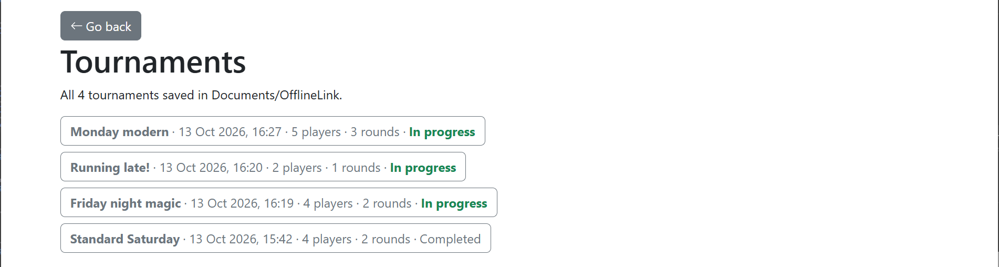
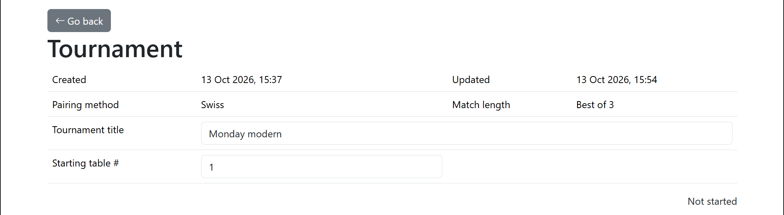
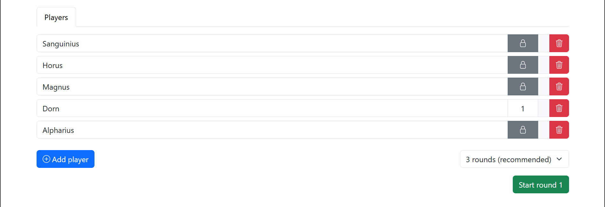
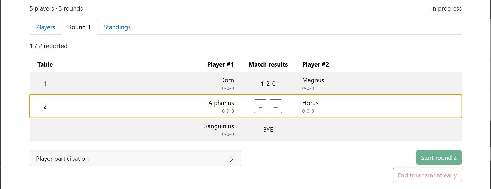
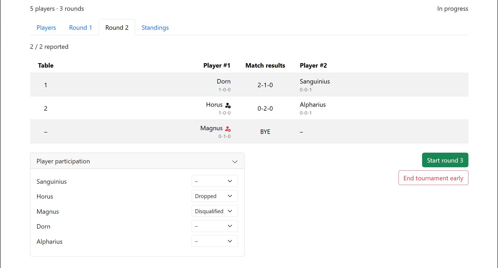
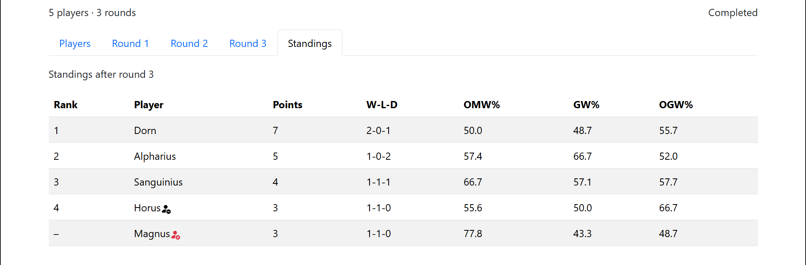
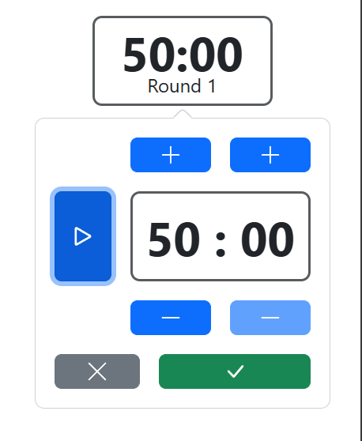
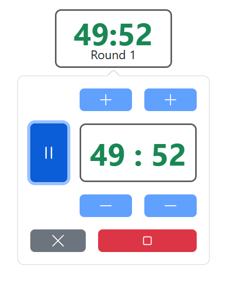

# OfflineLink

An unofficial, offline desktop tournament notebook for Magic: The Gathering organizers. Official Wizards reporting stays in [EventLink](https://wpn.wizards.com/en/news/definitive-guide-wizards-eventlink).

## Download latest release

- [Windows](https://github.com/AndreasArvidsson/offline-link/releases/latest/download/OfflineLink-Windows.zip)
- [Linux](https://github.com/AndreasArvidsson/offline-link/releases/latest/download/OfflineLink-Linux.zip)
- [macOS](https://github.com/AndreasArvidsson/offline-link/releases/latest/download/OfflineLink-macOS.zip)

For more details read the [installation and uninstallation instructions](./INSTALLATION.md).

## Privacy policy

OfflineLink stores tournament data, including player names and match results, in JSON files in `Documents/OfflineLink` on your computer. It does not upload this data or include analytics, telemetry, or automatic crash reporting. The released application loads its interface and assets locally and does not require an internet connection.

If your Documents folder is managed by a cloud synchronization service, that service may synchronize these files according to your settings and its privacy policy.

## User guide

### Home screen

- `New tournament` button - Open the tournament view with a new empty tournament.
- `All tournaments` button - Open the tournament's view showing a list of all tournaments.
- `Active timers` section - Show active (running and paused) timers, if any.
- `Recent tournaments` section. Show the top 10 tournaments from the tournament's list.

### Tournaments

- Shows all tournaments saved in `Documents/OfflineLink`.
- Tournaments are saved automatically as JSON files.
- In-progress tournaments appear first, with the most recently updated first.
- Each entry shows the title, last updated timestamp, player count, round count and status.
- Click on a tournament to open it.

### Create new tournament

- `Created` - Timestamp when the tournament was created.
- `Updated` - Timestamp when the tournament was last updated.
- `Pairing method` - Which method is used to pair players. Only `Swiss` is currently available.
- `Match length` - How many games is a match. Only `Best of 3` is currently available.
- `Tournament title` - The name of the tournament.
- `Starting table #` - The number of the starting/first table. Can be used to run multiple tournaments in parallel.

### Add players

- Add name of participating players.
- Press enter when inserting a player name to jump to a new player.
- Requires at least 2 players.
- Recommended number of rounds is calculated on the player count.
- Manual override of number of rounds is available.

### Table locking

- Players can be locked to a table. That player will always be paired at the same table. A match between two table locked players will use the lower table number.
- Press padlock icon to lock the player to a table.
- Delete table number and press enter or click outside to remove table lock.

### First round

- Players have been paired and assigned a table.
- With an odd number of players, one player receives a bye and an automatic win.
- Click on row to select a match, use number keys to insert match score.
- Score order is Player #1 wins, Player #2 wins, then draws. For example, `120` records a 1-2-0 result.
- Either insert two numbers and hit enter or insert three numbers to advance to next match.
- All matches must be reported before starting the next round.
- Use `Complete tournament` after the final round, or `End tournament early` to finish sooner.

### Player participation

- Player participation is the way to report changes in player participation.
- Players can be reported as `Dropped` or `Disqualified`.
- Dropped players will be marked with a black "- person" icon.
- Disqualified players will be marked with a red "x person" icon.
- Neither will be paired in following rounds.
- Dropped players keep their rank in standings. Disqualified players have no rank.

### Standings

- Standings are calculated from completed rounds.
- `Rank` - The player's place in the tournament.
- `Points` - Match points. 3 for a win, 1 for a draw, 0 for a loss.
- `W-L-D` - Match wins, losses and draws.
- `OMW%` - Opponents' match win percentage.
- `GW%` - The player's game win percentage.
- `OGW%` - Opponents' game win percentage.
- Players are ranked by points, then [tiebreaks](#tiebreaks).

### Timer

- Click on the timer to open its controls. Default duration is 50 minutes.
- When stopped, change minutes and seconds directly or use the `+` and `-` buttons.
- Play button - Start or resume the timer.
- Pause button - Pause the timer.
- Green checkmark button - Save the duration without starting the timer.
- Red stop button - Stop and reset the timer.
- `x` button - Close the controls without saving duration changes.
- Running timers are green and count down. Overtime timers are yellow and count up.
- Starting the next round stops and resets the timer.

## Developer tools

Press `F12` to open or hide the developer tools.

## Rule definitions

OfflineLink is based on the [Magic Tournament Rules (MTR) - Feb 27, 2026](https://media.wizards.com/ContentResources/WPN/MTG_MTR_2026_Feb27_EN.pdf).

## Swiss pairing algorithm

OfflineLink uses [Swiss-system pairings](https://en.wikipedia.org/wiki/Swiss-system_tournament).

[MTR: 10.4 Pairing Algorithm](https://media.wizards.com/ContentResources/WPN/MTG_MTR_2026_Feb27_EN.pdf#page=44)

The MTR specifies tournament policy, but does not fully define the Swiss pairing procedure. OfflineLink’s pairing choices are described below; identical pairings to EventLink are not guaranteed.

### Number of rounds

[MTR: Appendix E—Recommended Number of Rounds in Swiss Tournaments](https://media.wizards.com/ContentResources/WPN/MTG_MTR_2026_Feb27_EN.pdf#page=55)

OfflineLink’s default number of Swiss rounds:

| Players | Rounds |
| ------- | -----: |
| 2       |      1 |
| 3–4     |      2 |
| 5–8     |      3 |
| 9–32    |      5 |
| 33–64   |      6 |
| 65–128  |      7 |
| 129–226 |      8 |
| 227–409 |      9 |
| 410+    |     10 |

These are the app’s defaults rather than an exact reproduction of Appendix E. The MTR specifies single elimination for 5–8 players and 4 Swiss rounds for 9–16 players in Limited events with a Booster Draft playoff. Playoff rounds are separate from the Swiss round count. The app’s calculation uses the player count without adjustments for awarded byes.

### First round

First-round pairings and bye selection are random.

### Following rounds

- Before the final round, pairings favor small match-point gaps across the whole field. First, prefer the pairings with the smallest maximum gap in any single match. If that is tied, prefer the smallest total gap across all matches.
- Rematches are avoided whenever complete pairings without them are possible. Otherwise, the tournament continues with the fewest rematches possible.
- With an odd number of active players, prefer bye recipients with the fewest previous byes, then lowest standing, subject to minimizing rematches.

### Final round

- Pair players in standings order, start with the highest-ranked player and work down the standings, including tiebreakers. For each player, prefer the highest-ranked available opponent while avoiding rematches and preserving valid pairings for everyone else.
- If rematches are unavoidable, minimize rematches and apply the bye preference, then pair in standings order. Try fresh opponents first, followed by previous opponents, choosing the highest-ranked opponent who preserves the minimum rematch count. This fallback is OfflineLink’s policy.
- Bye selection follows the same rules as previous rounds.

Rematch restrictions can make these two approaches produce different pairings even when every player has different match points.

The final-round rank preference follows Wizards’ [EventLink power-pairing description](https://wpn.wizards.com/en/news/eventlink-release-notes-september-28-2021). That description does not specify what to do when rematches are unavoidable.

### Tiebreaks

[MTR: 3.1 Tiebreakers](https://media.wizards.com/ContentResources/WPN/MTG_MTR_2026_Feb27_EN.pdf#page=15)\
[MTR: Appendix C—Tiebreaker Explanation](https://media.wizards.com/ContentResources/WPN/MTG_MTR_2026_Feb27_EN.pdf#page=51)

Players are ranked using the following criteria, in order:

1. Match points
2. Opponents’ match-win percentage
3. Game-win percentage
4. Opponents’ game-win percentage

Disqualified players appear below all other players and receive no rank, regardless of their match points or tiebreakers.
